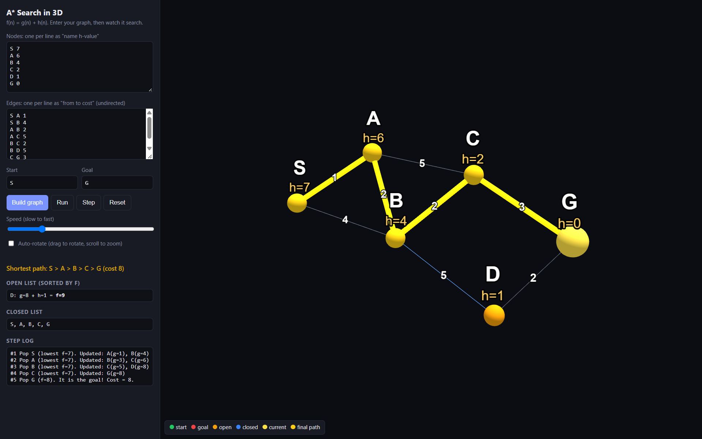
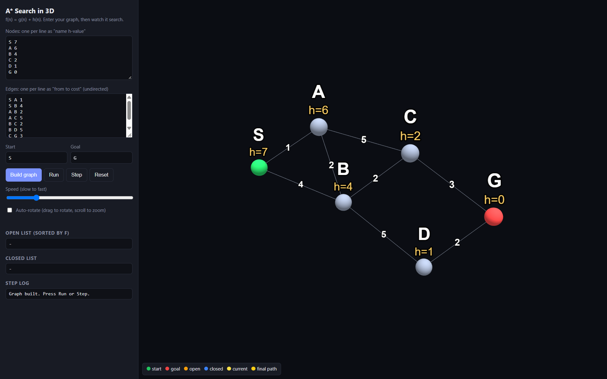

# A* Search 3D

A simple 3D visualizer for the A* pathfinding algorithm. Enter a custom graph, set the start and goal nodes, and watch the algorithm find the shortest path step by step.

Built using HTML, CSS, JavaScript and [Three.js](https://threejs.org/).

## Features

- Custom graph input with weighted edges and heuristic values.
- Interactive 3D visualization with Run and Step modes, rotation and zoom.
- Step-by-step A* search with node states, heuristic validation and shortest path cost.

## Overview




## Getting Started

1. Clone the repository.
2. Open `index.html` in your browser.
3. Enter your graph or use the default example.
4. Set the start and goal nodes.
5. Click **Build Graph**, then **Run** or **Step**.

An internet connection is required to load Three.js from its CDN.

## Input Format

**Nodes** (one per line):
```text
S 7
A 6
B 4
G 0
```

**Edges** (one per line):
```text
S A 1
A B 2
B G 3
```

Edges are bidirectional and include their traversal cost.

## Project Structure
```
Astar-3d/
├── docs/
├── index.html
├── style.css
├── script.js
├── README.md
└── .gitignore
```

The A* algorithm is implemented from scratch in `script.js` using `f(n) = g(n) + h(n)`.

## Author

Samarth Varshney